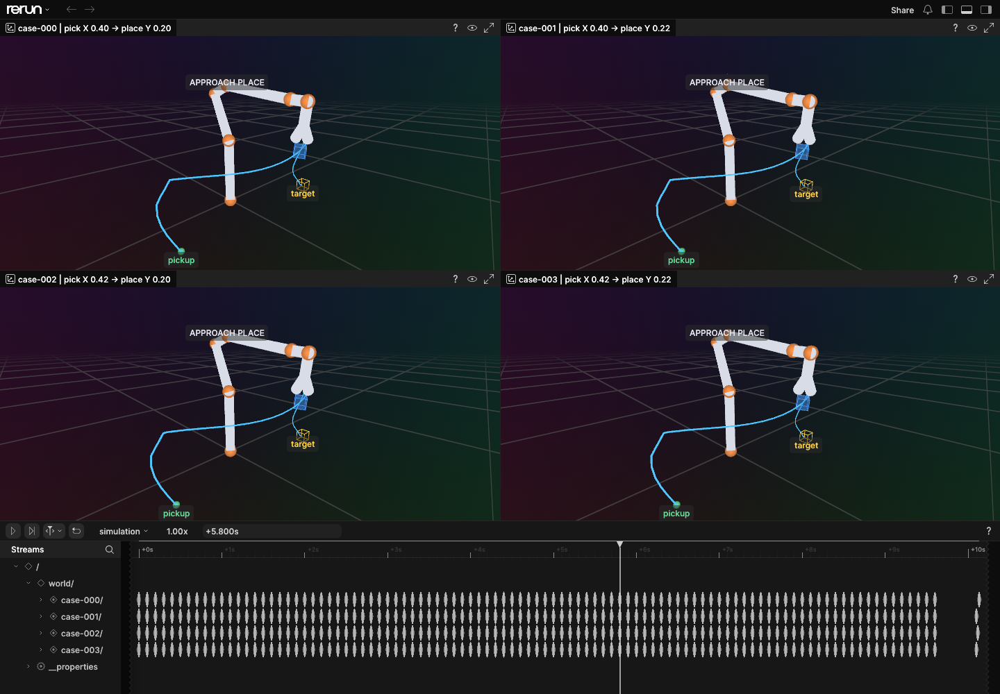
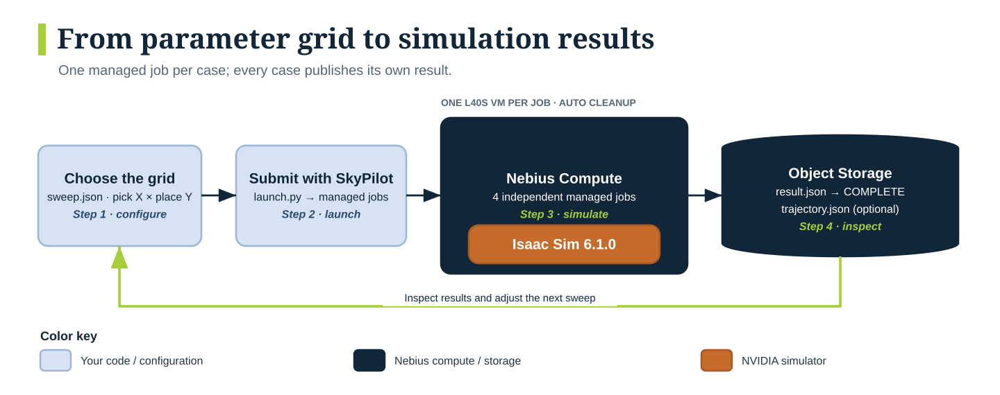
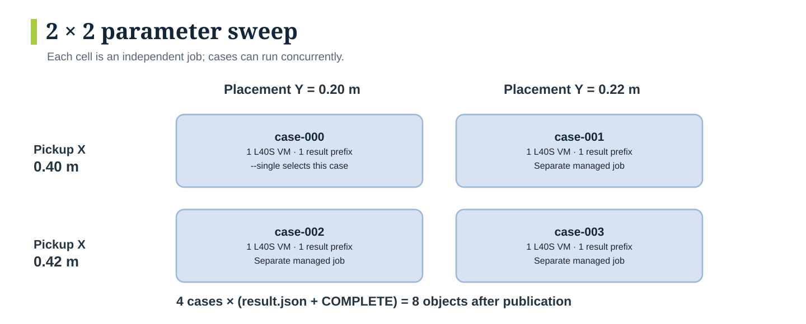
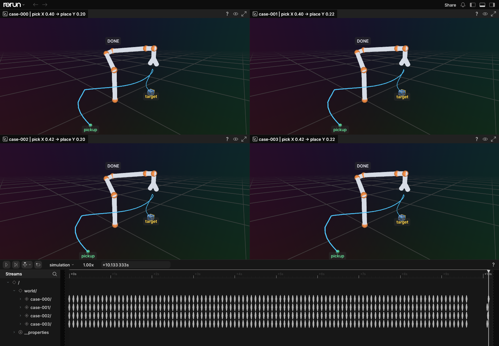

# Isaac Sim pick-and-place sweep on Nebius with SkyPilot

Run a Franka Panda pick-and-place simulation on a Nebius Compute GPU VM.
Start with one case, then submit four independent [SkyPilot managed jobs](https://docs.skypilot.ai/en/latest/examples/managed-jobs.html).
Each job runs the committed Docker image, writes its measured result to Nebius Object Storage, and releases its worker VM when finished.

**Cloud verified on November 2, 2026:** one case and the four-job sweep passed, with all results downloaded and worker cleanup checked. [See the results](#validation).



*Four independent Nebius Compute jobs approaching their placement targets at 5.8 seconds of simulated time, from the November 2 SkyPilot sweep. Blue cubes and cyan paths show measured motion; green marks pickup and yellow marks the target.*

This is a self-contained adaptation of the [Serverless Isaac Sim recipe](https://github.com/nebius/serverless-ai-cookbook/tree/354ad615ed8d4e07532125bb82add11fed5992f8/robotics/isaac-pick-place-sweep).
The simulation and result fields are the same; SkyPilot provisions and manages the VMs.

**Jump to** [Setup](#1-connect-skypilot) · [One case](#4-run-one-case-and-inspect-its-result) · [Four-job sweep](#5-submit-the-four-job-sweep) · [Motion replay](#optional-motion-replay-with-rerun)

## How the sweep works



Your grid defines the cases. SkyPilot manages a worker for each job, and each simulation publishes to its own S3 prefix. Inspect the results before adjusting the next grid.

## Before you start

- A Nebius project with quota for one L40S GPU in `eu-north1`; four concurrent jobs need four GPUs. Available capacity can limit concurrency.
- A configured [SkyPilot API server with Nebius access](https://docs.nebius.com/3p-integrations/skypilot), an authenticated [Nebius CLI](https://docs.nebius.com/cli/), Docker, AWS CLI, and Python 3.13.
- A [Container Registry](https://docs.nebius.com/container-registry/quickstart) and an [Object Storage bucket with access keys](https://docs.nebius.com/object-storage/quickstart).

The default VM uses one **L40S**, at least 8 vCPUs and 32 GB RAM, and a 150 GB boot disk. Isaac needs an RTX GPU; H100 and A100 are unsupported.
The default boot image is `computeimage-e00z45axwdzgve5e2d`, an AMD64 Ubuntu 24.04 CUDA 13 image in `eu-north1`, released on October 23, 2026. It supplies Docker and NVIDIA tooling. Check the driver printed in the setup logs against [NVIDIA's Isaac Sim 6.1 requirements](https://docs.isaacsim.omniverse.nvidia.com/6.1.0/installation/requirements.html), which list Linux driver 595.58.03.
The VM needs outbound HTTPS for the registry, Object Storage, and `omniverse-content-production.s3-us-west-2.amazonaws.com`.

Compute VMs, boot disks, Object Storage, and the API server can incur charges. Test one case before starting the sweep.

## 1. Connect SkyPilot

From the repository root:

```bash
cd skypilot/isaac-pick-place-sweep
python3.13 -m venv .venv
source .venv/bin/activate
python -m pip install -r requirements.txt
```

If you use Nebius's Managed SkyPilot API Server, copy its endpoint from the console:

```bash
sky api login -e '<your-skypilot-api-server-endpoint>'
sky check nebius
```

Use a server compatible with the pinned SkyPilot client, **0.14.2**, including support for task secrets. If you already use a configured API server, keep that connection and run `sky check nebius`.
Cloud credentials belong on the API server; signing into the Nebius CLI on your laptop alone does not configure a remote server.

For a local API server, install the same requirements in its environment. The file also pins `grpcio==1.83.0`: concurrent provisioning with 1.85.1 crashed in gRPC's native fork handler on the macOS test controller. Installing client dependencies does not update an already-running remote server.

Configure the project and subnet on that server too. Merge this region mapping into its SkyPilot configuration, replacing the placeholders with your existing resource IDs:

```yaml
nebius:
  region_configs:
    eu-north1:
      project_id: <your-project-id>
      subnet_id: <your-subnet-id>
```

The server administrator can apply this through the server's configuration. For a new local server, set it in `~/.sky/config.yaml` before starting the server. This mapping avoids ambiguous project discovery and selects the network for the workers.

## 2. Build and push the image

The [Dockerfile](Dockerfile) pins NVIDIA Isaac Sim **6.1.0** by digest and copies [run.py](run.py) into the image. NVIDIA's image already includes `boto3` for S3 uploads.

```bash
export REGION='eu-north1'
export IMAGE="cr.$REGION.nebius.cloud/<registry-path>/isaac-pick-place-sweep:v1"
nebius registry configure-helper
docker build --platform linux/amd64 -t "$IMAGE" .
docker push "$IMAGE"
```

The registry helper authenticates your local Docker client. Give the worker permission to pull the private image too:

```bash
export REGISTRY_SERVER="cr.$REGION.nebius.cloud"
export REGISTRY_USERNAME='iam'
export REGISTRY_PASSWORD="$(nebius iam get-access-token)"
```

Use your existing Nebius CLI profile with access to the registry. Generate a fresh token just before submitting jobs; it must still be valid when each worker pulls the image.
For a public image, leave all three `REGISTRY_*` variables unset.

## 3. Configure Object Storage credentials

Use an existing AWS CLI profile for the bucket, or create one with the bucket's access keys. These keys need write access for the jobs and read access for the commands below.

```bash
export S3_BUCKET='<bucket-name>'
export S3_ENDPOINT_URL="https://storage.$REGION.nebius.cloud"
aws configure --profile isaac-sweep
export AWS_PROFILE=isaac-sweep
export AWS_ACCESS_KEY_ID="$(aws configure get aws_access_key_id --profile "$AWS_PROFILE")"
export AWS_SECRET_ACCESS_KEY="$(aws configure get aws_secret_access_key --profile "$AWS_PROFILE")"
aws s3 ls "s3://$S3_BUCKET" --endpoint-url "$S3_ENDPOINT_URL"
```

The launcher sends the access keys and optional registry credentials through SkyPilot's `secrets` field. It does not write them into the task YAML, dry-run output, or local job manifest. Anyone administering the API server or worker can access job credentials; use bucket-scoped keys where possible.

## 4. Run one case and inspect its result

The first point in [sweep.json](sweep.json) uses pickup X **0.4 m** and placement Y **0.2 m**, near [NVIDIA's example](https://docs.isaacsim.omniverse.nvidia.com/6.1.0/core_api_tutorials/tutorial_core_adding_manipulator.html).
Inspect the task, then submit it:

```bash
python launch.py --image "$IMAGE" --bucket "$S3_BUCKET" --region "$REGION" --single --dry-run
python launch.py --image "$IMAGE" --bucket "$S3_BUCKET" --region "$REGION" --single
```

The launcher prints the run ID, managed job ID, and S3 path. It waits for submission acknowledgement, then returns while the simulation runs.
Copy the printed IDs:

```bash
export RUN_ID='<run-id-from-output>'
export JOB_ID='<managed-job-id-from-output>'
sky jobs logs "$JOB_ID"
sky jobs queue
aws s3 ls "s3://$S3_BUCKET/isaac-pick-place/$RUN_ID/case-000/" \
  --endpoint-url "$S3_ENDPOINT_URL"
aws s3 cp "s3://$S3_BUCKET/isaac-pick-place/$RUN_ID/case-000/result.json" result.json \
  --endpoint-url "$S3_ENDPOINT_URL"
python -m json.tool result.json
```

Confirm the managed job reaches `SUCCEEDED` **and** the case has these objects:

```text
isaac-pick-place/<run-id>/case-000/
├── result.json
└── COMPLETE
```

`COMPLETE` is an empty object uploaded only after `result.json` finishes uploading. It confirms publication, including results where the robot failed its task.

| Result field | Meaning |
| --- | --- |
| `run_id`, `case_id` | Connect the output to the local manifest and sweep point. |
| `isaac_sim_version`, `robot` | Simulator version and robot used. |
| `pick_position_m`, `target_position_m` | Initial cube position and requested placement, in metres. |
| `final_cube_position_m` | Measured cube position after settling. |
| `controller_done` | Whether the robot task finished without reporting failure. |
| `steps`, `max_steps` | Control steps used and the configured limit. |
| `xy_error_m`, `z_error_m` | Horizontal distance and vertical error from the target. |
| `success` | True only if the controller finished and both errors are at most **0.08 m**. |

A SkyPilot job can reach `SUCCEEDED` with `success: false`: Python finished and published a result, but the robot missed its goal.

## 5. Submit the four-job sweep

The two arrays in `sweep.json` form a Cartesian grid:

```json
{"pick_x": [0.4, 0.42], "place_y": [0.2, 0.22]}
```



`--single` selects the upper-left cell. The full sweep submits all four cells as independent jobs; the case numbers show submission order, not execution dependencies.

```bash
python launch.py --image "$IMAGE" --bucket "$S3_BUCKET" --region "$REGION" --dry-run
python launch.py --image "$IMAGE" --bucket "$S3_BUCKET" --region "$REGION"
```

Each combination gets a separate managed job and worker VM. There is no dependency between cases. SkyPilot schedules them as resources become available.

The launcher writes `runs/<run-id>/jobs.json` with each case's parameters, request ID, job ID, job name, and S3 URI. Accepted requests are saved before waiting for their job IDs. If submission is interrupted, inspect that manifest, `sky api status`, and `sky jobs queue` before resubmitting; earlier jobs may still be running.

After all four jobs finish, set `RUN_ID` to the sweep's printed ID and inspect its objects:

```bash
export RUN_ID='<sweep-run-id-from-output>'
sky jobs queue
aws s3 sync "s3://$S3_BUCKET/isaac-pick-place/$RUN_ID/" "results/$RUN_ID/" \
  --endpoint-url "$S3_ENDPOINT_URL"
```

Expect `case-000` through `case-003`, each with `result.json` and `COMPLETE` (eight objects in total). Check every job's terminal status and every result's `success` field.

## Optional motion replay with Rerun

Add `--record-motion` to either launch command. Each case also uploads `trajectory.json`, containing measured cube poses, Franka link positions, and task phases at 10 Hz, plus initial and settled final poses.

Download that run as above, then replay locally:

```bash
python -m venv .venv-rerun
source .venv-rerun/bin/activate
python -m pip install rerun-sdk==0.38.1
python visualize.py results/"$RUN_ID"/case-* --output results/pick-place.rrd
rerun results/pick-place.rrd
```

Scrub the `simulation` timeline to compare cases. This displays a simplified arm joining the measured link origins, the moving cube, its path, and its target. It is a pose replay, not a rendered Isaac camera view. Rerun is not installed in the cloud image.



*The same four cloud jobs after placement, viewed at 10.133 seconds. Use each case's `result.json` for its measured errors and success flag. See [image provenance](images/README.md) for the source of both screenshots.*

## Customize and clean up

- Edit `sweep.json` to change the grid; `--single` always selects its first point.
- Edit [task.yaml](task.yaml) for GPU resources, VM image, disk size, or the two-hour simulation timeout. Use an RTX GPU supported in your region. `--region` selects the same region for Compute and Object Storage.
- Edit `run.py` to change the task, or the Dockerfile to add dependencies. Build and push a new image tag after changes. Use a container image digest when you need reproducible environments. The default Compute image is already pinned by ID; select an image available in the destination region if you change `--region`.
- Review NVIDIA's license and privacy terms before running; the YAML sets `ACCEPT_EULA=Y` and `PRIVACY_CONSENT=Y`.

Managed jobs release their worker VMs and boot disks after completion or cancellation. The API server and any legacy jobs controller remain separate resources. Keep the API server if you use it for other work. Your registry image and S3 results also remain available.

To cancel this recipe's jobs, use only the IDs from its manifest:

```bash
sky jobs cancel <job-id> <another-job-id>
sky jobs queue
```

These are on-demand jobs. Application errors are not automatically retried; SkyPilot may restart a job after infrastructure failure. A restarted case uses the same S3 prefix, so wait for the final job state before interpreting results. The simulation timeout bounds each Docker run; queued or provisioning jobs may wait longer and can be cancelled as above.

## Troubleshooting

| Symptom | Check |
| --- | --- |
| `sky check nebius` fails | The connected API server's Nebius credentials, project, subnet, and permissions. |
| `No project found for region` | Set `nebius.region_configs.<region>.project_id` on the API server; an enabled cloud check alone does not select a project. |
| Image family cannot be resolved | Use the exact public Compute image ID from `nebius compute image list-public --region <region>`; this recipe pins the tested region's image. |
| Jobs stay pending | L40S quota and capacity in the selected region; inspect `sky jobs logs --controller <job-id>`. |
| Image pull fails | Full image path, registry access, and token expiry while the job was queued. |
| Docker or GPU setup fails | Use a GPU boot image with Docker and NVIDIA Container Toolkit; inspect `nvidia-smi` in setup logs. |
| Isaac fails at startup | RTX GPU, driver compatibility, EULA settings, and outbound access to hosted assets. |
| Upload fails | Bucket name, region, and access-key permissions. A failed upload must not be treated as a complete result. |
| Job succeeds but robot task fails | Inspect `controller_done`, final cube position, and XY/Z errors; try the default first point. |

## Validation

Local checks cover grid expansion, SkyPilot task parsing, submission receipts, secret handling, result evaluation, and upload ordering. Run them without a GPU:

```bash
python -m unittest discover -s tests -v
python launch.py --image example/image:v1 --bucket example-bucket --dry-run
```

### Verified cloud run — November 2, 2026

The documented single case and recording sweep ran on **Nebius Compute in `eu-north1`**, with one L40S, 8 vCPUs, 32 GB RAM, and a 150 GB boot disk per job. Workers reported NVIDIA driver **610.57.04**. The API server ran locally on macOS with SkyPilot 0.14.2; this test did not deploy Nebius's Managed SkyPilot API Server.

The managed job IDs below belong to that isolated test server. Use the run IDs and artifact hashes in the verification record to identify its durable outputs.

| Run | Managed job IDs | Robot-task success | XY placement error | S3 objects | Cold-start total time |
| --- | --- | --- | --- | --- | --- |
| Single case | 1 | 1/1 | 1.17 cm | 2 | 15.0 min |
| Four-job sweep | 6–9 | 4/4 | 1.17–1.27 cm | 12 | 15.6–17.9 min per job |

Every job reached `SUCCEEDED`. All **14 S3 objects** were independently downloaded and hashed. The four recordings each contain **98 measured frames** covering about 10.1 seconds of simulation. Their timestamps increase, cube quaternions are normalized, and every final recorded cube pose matches its `result.json`. The generated Rerun file passed `rerun rrd verify` and supplied the screenshots above.

The cold-start times include provisioning, pulling and extracting the roughly 32 GB unpacked image, and initial Isaac startup. SkyPilot reports a managed job as `RUNNING` during image setup too; use the logs to distinguish setup from simulation.

The five successful workers and their five managed boot disks were automatically deleted. Exact-ID queries to the Nebius API returned `NOT_FOUND` for each. A prior sweep was cancelled after a native gRPC 1.85.1 crash on the macOS controller; its two partially created VMs were manually removed before retrying with the pinned gRPC 1.83.0. No test VMs or boot disks remain.

The tested container digest is `sha256:d2038691649b74ddcb165f2feb1aed4a959ff02488cf715ebb0c3892a7fe857d`. See the [verification record](validation/2026-11-02.json) for run IDs, per-case metrics, artifact hashes, runtime file hashes, and cleanup evidence. Bucket, account, and registry identifiers are omitted from that record.
